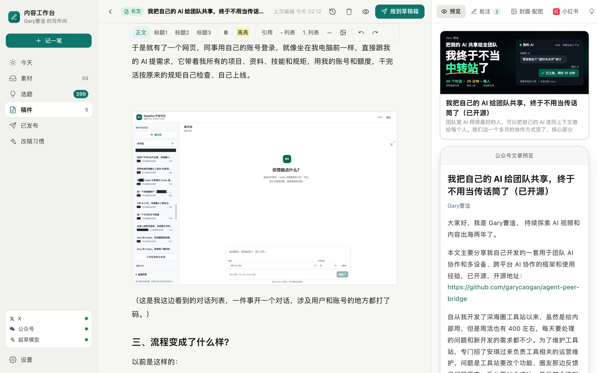
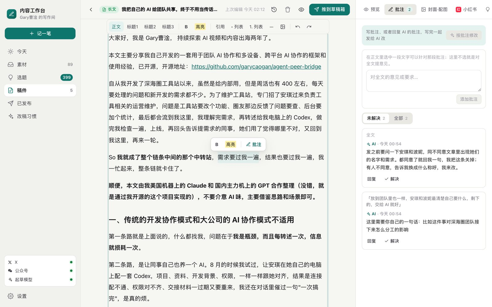
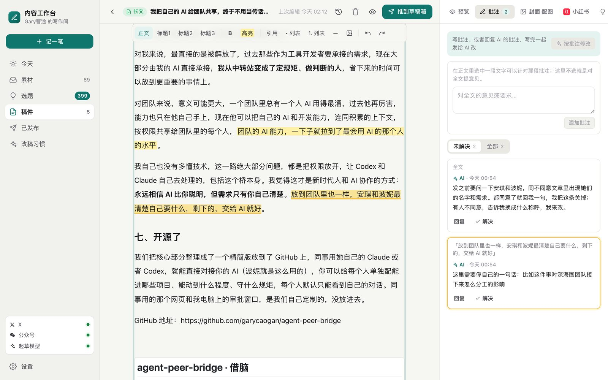
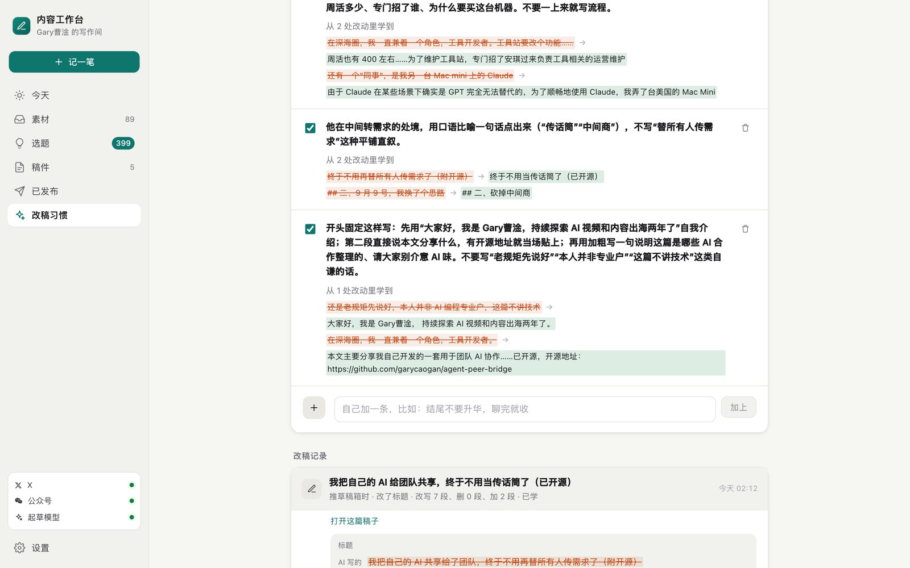
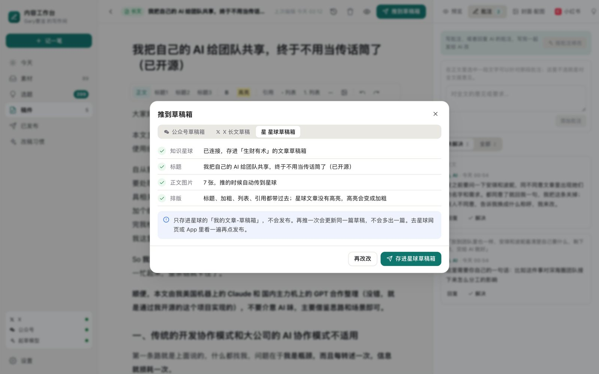
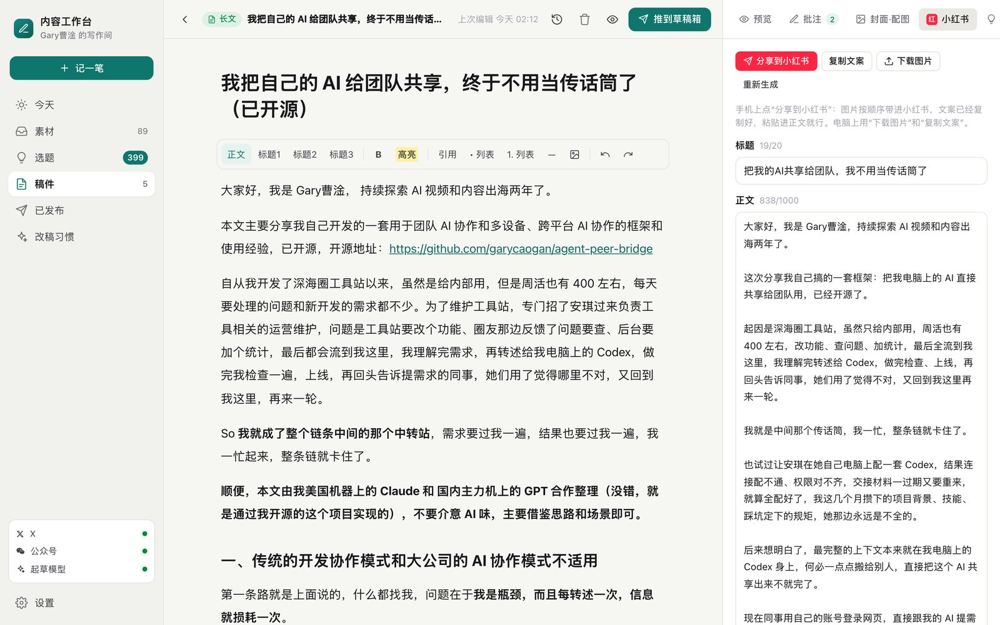
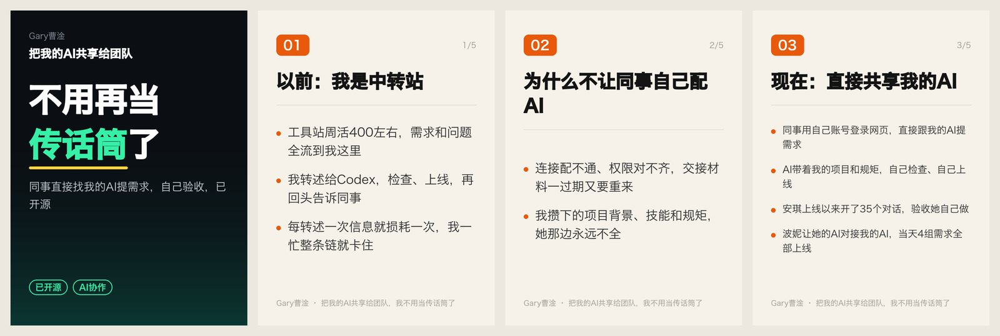

# 内容工作台（content-workbench）

把你每天说过的话、开过的会、写过的文档，变成能发的稿子：AI 只摘你自己的原话提炼选题，照你的写法起底稿，你在一个页面里看图、批注、改完，一键推进**公众号草稿箱、X 长文草稿、知识星球草稿箱**，再一键做成**小红书**图文。每篇稿子在**飞书**里只对应一个文档，原地更新留档。它还会记下你每次怎么改 AI 的底稿，总结成你的改稿习惯，下次起稿就照着来。

所有东西都跑在你自己的电脑上，数据只存在本机的私有目录里。它只把稿子放进各平台的**草稿箱**，最后点发表的永远是你自己。

作者：Gary（曹淦）。这是我自己每天在用的工具，前因后果写在[这篇文章](#文章)里。



## 它能做什么

**收素材**：随手记、录音（本机 Whisper 转写，音频不出电脑）、飞书妙记（每两小时自动拉你自己的）、飞书文档和表格。

**提选题**：每条素材自动提炼几个能写的选题，每个选题挂着你在素材里的原话；会议里分不清是谁说的话只当背景，不当你的观点。

**起底稿**：按你的文风指南和你过去的文章起底稿，自动做基础排版（三级标题、加粗、高亮），跑一遍文风检查。需要你亲自写一句、或者要你确认的地方，不写进正文，挂成批注。

**改稿**：所见即所得的编辑器，图片直接显示在正文里，粘贴或拖进来就是一张配图。选中一段文字就能批注，像飞书评论一样挂在侧栏；AI 留的批注你可以直接回复。写完点“按批注修改”，AI 一次改完、每条都回复改了什么，改完能看前后对比、能一键撤回。





**改稿习惯**：你在 AI 底稿上的每一轮修改（包括标题）都会记下来，攒够几次，AI 总结成具体的习惯，带着你真实改过的例子，之后起稿和改稿都照着做。你可以改、关掉或者自己加。



**发出去**：长文选一个平台推进草稿箱。公众号会自动传正文图片和封面（方形小图能选裁哪块）；X 走官方 Articles 接口建长文草稿；知识星球存进“我的文章-草稿箱”，再推一次是更新同一篇。三边各转成自己支持的排版，X 和星球没有高亮，高亮会变成加粗。



**小红书**：从长文一键生成小红书版（20 字以内的标题、1000 字以内的正文、话题标签），自动画一张封面卡和几张要点卡，可以加长文里的截图、调顺序、改卡片上的字重画。手机上点“分享到小红书”，图片按顺序带进小红书 App，文案已经复制好；在电脑上就下载图片包。





**短视频**：把长文做成一条竖屏口播视频（抖音、视频号、小红书）。AI 先写分镜脚本：每个镜头读什么、画面上出什么字、用哪张截图、推近到哪一块（它会先看一遍文章里的截图）。左边栏的「视频」里每条视频有一个整屏工作区：左边是镜头列表，中间改选中的镜头（口播、镜头类型：开头大字、要点卡片、截图放大、数字、前后对比、金句、结尾，还能在截图上拖框选要推近的区域），右边当场预览这个镜头，不用等渲染；口播改过的句子点一下“配音试听”才会重新配音。满意了点“出片”，这台电脑就配音、对齐字幕、渲染成 1080×1920 的 MP4，两分钟的片子大约三到五分钟；成片里点哪个镜头就跳到哪一段。画面用 [HyperFrames](https://github.com/heygen-com/hyperframes)（HTML + GSAP 渲染成视频）生成，每个镜头的元素在读到对应那句话时出现。手机上点“分享到手机 App”直接发。

**留档**：每篇稿子在飞书的固定文件夹里只对应一个文档，停笔一分半钟后自动同步（正文、图片、发布信息、小红书版），改动看飞书的历史版本。你在飞书里直接改过的，工作台不会覆盖，会停下来等你决定。

**找案例**（可选）：如果你是生财有术的会员，可以开启生财 MCP，起稿和改稿时 AI 会去深海圈帖子、精华区、项目案例库里找真实案例，出处写进备注。

**手机上也能用**：整个页面适配手机，配合 Cloudflare Tunnel + Access 可以用自己的域名、邮箱验证码登录。

## 它不做什么

- 不替你发表。所有平台都只到草稿箱，发表要你自己点。
- 小红书个人号没有发布接口，工作台只负责把图和字准备好，最后在小红书 App 里存草稿或发布。
- 知识星球没有开放接口，用的是星球网页自己调的接口，星球改版时可能需要跟着改。
- 起稿和改稿调用的是你电脑上登录的 Claude Code（你自己的订阅），文字会发给 Anthropic 处理，不是离线运行。
- 短视频的配音调用 Evolink 的中文 TTS（按量计费，一条两分钟的片子几分钱），口播文字会发给它处理；对齐字幕和渲染在本机。用自己的声音配音时，那段朗读录音也会上传到 Evolink 的文件服务用于复刻（随机链接，72 小时后失效）。

## 怎么装

最省事的办法：把这个仓库的链接丢给你自己的 Claude Code 或 Codex，让它照着这份说明帮你装、帮你配。下面是它需要知道的。

需要：macOS（录音转写和视频字幕对齐用 Apple 芯片上的 mlx-whisper，开机自启用 launchd）、Python 3.13 和 [uv](https://docs.astral.sh/uv/)、Node 22+、ffmpeg、已登录的 Claude Code。短视频第一次出片时会用 npx 下载 HyperFrames 和它的无头 Chrome（`npx hyperframes browser ensure`），字体（Noto Sans SC，OFL）从 Google Fonts 的仓库下载到数据目录。可选：飞书的 lark-cli（飞书素材和留档）、Playwright 的 Chromium（知识星球扫码）、cloudflared（外网访问）。

```bash
git clone https://github.com/garycaogan/content-workbench.git && cd content-workbench
uv sync --extra transcribe            # 不需要录音转写就去掉 --extra transcribe
(cd web && npm install && npm run build)
.venv/bin/playwright install chromium # 只有知识星球扫码需要
.venv/bin/content-workbench serve     # 打开 http://localhost:8765
```

第一次打开要注册一个 passkey，初始化码用 `.venv/bin/content-workbench setup-code` 查看。

让 Claude Code 能在后台起稿：`claude setup-token` 生成一个长期令牌，存成权限 600 的文件，然后

```bash
.venv/bin/content-workbench configure --claude-token-file ~/.claude-oauth.token
```

开机自启：把 `deploy/content-workbench.plist.example` 里的三个占位换掉，放进 `~/Library/LaunchAgents/` 再 `launchctl bootstrap`。

外网访问：工作台只监听本机。用 Cloudflare Tunnel 接到你的域名，前面加 Cloudflare Access（只放行你的邮箱），然后

```bash
.venv/bin/content-workbench configure --public-host write.example.com \
  --access-team <团队名> --access-aud <应用 AUD> --access-email you@example.com
.venv/bin/content-workbench configure --login access   # 收到邮箱验证码就算登录，不用再绑 passkey
```

工作台会在每个请求上校验 Access 令牌的签名、受众、有效期和邮箱，校验不过一律拒绝。

## 配成你自己的

设置都在数据目录的 `settings.json` 里（默认 `~/.local/share/content-workbench/`，目录 0700，文件 0600）。和“你是谁、你怎么写”有关的几项：

| 设置 | 作用 |
| --- | --- |
| `author` | 署名，也是页面上称呼你的名字 |
| `persona.name` / `persona.identity` | 提示词里怎么称呼你、你是做什么的 |
| `persona.speaker_hint` | 会议逐字稿里别人怎么叫你（用来判断哪段是你的原话） |
| `persona.x_style` | 你在 X 上的写法 |
| `persona.domain` | 你的领域，用来选小红书话题 |
| `voice_guide_path` | 你的文风指南（Markdown），写得越具体，底稿越像你 |
| `manual_path` | 你的身份和边界说明，哪些话不说、哪些承诺不做 |
| `kb_root` / `skill_dir` | 可选：你的知识库和一套写作脚本（找最接近的历史文章当样本、文风检查） |
| `transcribe_vocab` | 录音转写和视频字幕对齐时常见的词，逗号隔开 |
| `case_search` | 填 `scys` 开启生财 MCP 找案例 |
| `zsxq_group_id` / `zsxq_group_name` | 知识星球草稿存到哪个星球（星球网页地址里 `groupId=` 后面那串数字），也可以在设置页填 |
| `evolink_key_file` | 短视频配音用的 Evolink API key 文件（权限 600） |
| `video_voice` | 默认音色，比如 `longanyang_v3.1`，视频页里也能换 |
| `video_tagline` | 视频左上角名字下面的一行小字 |
| `video_bgm` | 背景音乐文件（wav/mp3），不填就用数据目录里的 `video/bgm.wav`，都没有就不配乐 |
| `video_clone_ref` / `video_clone_name` | 用你自己的声音配音：一段你本人朗读的录音（10 到 60 秒，单声道 WAV），Evolink 据此复刻音色，音色列表里会多出这一项（名字默认“我的声音”）；`video_voice` 填 `clone` 就默认用它。复刻出的音色 6 小时过期，工作台会自动重新复刻 |

平台凭证（X、公众号、知识星球）在设置页里填或扫码，只存在本机的 `secrets.json`，页面上只显示“已填/未填”。

- **X**：在 developer.x.com 建一个 Native App（OAuth 2.0 PKCE，读写权限，要 `media.write`），回调地址填设置页上显示的那个。长文需要账号有 Premium，接口按次计费。
- **公众号**：填 AppID 和 AppSecret，把这台电脑的出口 IP 加进公众号后台的 IP 白名单。个人主体、未认证的号只能推草稿箱。
- **知识星球**：设置页“扫码连接”，勾选同意星球的用户协议后，用微信扫二维码。
- **飞书**：装好 lark-cli 并用你自己的身份授权，素材导入和留档都用它。

## 安全上的约定

- 平台凭证、素材、稿子、图片都只在本机的私有目录里。
- 推送都要在确认框里点确认；结果不确定的记成“不确定”，不会自动重发；只推进草稿箱，不发表。
- AI 改稿弄丢了正文里的图片，这一轮直接作废，原稿不动。
- 飞书文档在工作台之外被改过，不覆盖。

## 开发

```bash
uv run pytest          # 后端测试
cd web && npm run dev  # 前端开发；正式用 npm run build，后端直接提供 web/dist
```

## 文章

《我让 AI 给我搭了个内容工作台》，发在我的公众号和 X（[@GaryAIytb](https://x.com/GaryAIytb)）。

## 许可

MIT © 2026 Gary（曹淦）
